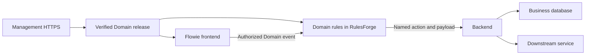

# Domain Release packages and runtime activation

**Domain Configuration** is the gateway deployment YAML. It owns identities' provider settings,
TLS trust, signing trust, worker paths and downstream connections.
**Domain Packages** is the gateway management HTTPS interface for named, signed
`.tar.zst` packages scoped to one Domain and environment. Operators and CI upload, validate
and activate packages containing an ACL and any stateful RulesForge pipeline for that Domain.
The gateway applies the active ACL and runs the signed rules on its RulesForge worker.
Identity and downstream business data have their own stores and operators.

## Archive and release identity

| Entry | Contents |
| --- | --- |
| `manifest.json` | UTF-8 object with `name`, `domain`, `environment`, `base_release`, `entrypoints` and `files`. |
| `manifest.p7s` | DER, single-signer detached SM2/SM3 CMS SignedData over the exact bytes of `manifest.json`. |
| Payload entries | The Domain ACL and the processing artifacts for that Domain declared in the signed file list, including the optional Praktor YAML. |

`name` is the package's logical name, such as `device-a-rules`. Use 1 to 64
ASCII characters, starting with a lowercase letter or digit. Subsequent
characters may also include `-`, `_`, and `.`. Releases of the same package
may share a name. The signed `domain` and `environment` bind its scope. The
compressed archive digest identifies the exact release for activation and
rollback. An upload of a new digest requires a signed name. Previously stored unnamed
manifests remain readable and recoverable, and an exact upload replay returns the existing receipt.

`base_release` is the active release digest from which this snapshot is derived. `null` is valid
for the initial release only. `entrypoints.acl` names an entry under `files`. New ACL
packages omit `entrypoints.routes`. Previously signed packages with a referenced
`routes: []` document remain eligible for validation and recovery. Optional
`entrypoints.praktor` names a distinct, signed YAML entry of up to 64 KiB.
`entrypoints.rulesforge` declares `rules/program.json` as the RulesForge Program descriptor.
The descriptor has its own nonempty entry in `files`. The reserved descriptor path requires
this declaration so an ACL-only activation cannot accidentally omit a bundled Program.
Each `files` item has
`path`, `size` in bytes and `sm3` as 64
lowercase hex digits. It accounts for exactly one payload entry. Reject duplicate JSON keys
after decoding escapes, ambiguous entry paths and undeclared fields in published schemas.
Use ASCII `/`-separated relative names with lowercase letters, digits, `.`, `_` and `-` in each
component and a 240-byte path limit. Reject empty components, traversal, terminal dots, Windows
device names, symlinks, directory records, encrypted entries and paths that collide as a file
and implied directory.

The release digest is SHA-256 of the exact `.tar.zst` bytes. The signed
manifest authenticates the configuration even when someone recompresses the same files. A
repacked or re-signed archive has a new release digest. Keep the SM3 of the manifest and the
authenticated signer identity in the audit record. Package digest, manifest hash and ACL policy
version serve different purposes.

Initial service limits are 8 MiB compressed, 32 MiB for the decoded TAR including headers and
padding, 8 MiB for any
payload entry, and 256 entries including the manifest and signature. The manifest cap is 64 KiB
and the DER cap comes from `SALTS_CRYPTO_SM2_CMS_MAX_DER`. These are admission limits with both
per-upload and process-wide budgets. Deny checked-size overflow and stop reads at the first
limit. Verify the signed manifest before interpreting its JSON, then hash each exact TAR file
body and match the results against the authenticated manifest. An
entry-reader error rejects the whole upload. The service holds a private read-only archive
object and parses verified entries into owned values. Where a worker needs a file, the host
materializes a verified entry under a private directory using host-chosen names. User-supplied
paths never become extraction targets.

### USTAR and Zstandard

The package is one size-declared ordinary Zstd frame containing a USTAR stream of regular
files. Validate the frame's exact compressed extent, declared content size and 32 MiB maximum
window with the pinned static Zstd package before allocating decoded storage. The frame must
have dictionary ID zero. `Salts::Core` `zstd_decompress` expands the frame into a bounded
caller-owned buffer and the actual length must match its declaration. CMake uses the Zstd
package already available in the shared vcpkg cache for frame inspection.

Read each 512-byte USTAR header, verify its checksum and regular-file type, join the full raw
prefix and name, and check bounds before reading the octal-size body. Check zero padding and
require at least two end blocks, followed only by zero padding. Reject PAX and GNU extension
entries, links, sparse encodings, directory entries and unsafe paths. Retain decoded bytes only
for the lifetime of the verified archive handle. A release revocation or schema failure
publishes no payload views. [Zstandard format and media type](https://www.rfc-editor.org/rfc/rfc8878.html)

Write an uncompressed USTAR file first and compress that regular file with Zstd so the frame
declares the TAR size. For example, after creating the signed manifest and payload files:

```sh
tar --format=ustar -cf release.tar manifest.json manifest.p7s acl.yml
zstd release.tar -o release.tar.zst
```

The HTTP body is the `.tar.zst` with `Content-Type: application/zstd` and identity transfer
representation. Treat any other `Content-Encoding` as unsupported. Return the exact compressed
bytes on download. The future upload owner reserves the compressed and expanded budgets before
collection. Four maximum-size uploads reserve up to `4 × (8 MiB + 32 MiB) = 160 MiB` for body and
decoded buffers alone, plus bounded index, decoder, verification and repository workspace.

## Certificate policy

The deployment authorizes each signer separately for each Domain and environment. Its signer
record supplies the CMS profile, pinned expected leaf public key, ordered leaf-to-intermediate
path, out-of-band trust anchor, CMS signer ID and the SM2 issuer ID for each certificate. An
untrusted signer identifier can select a configured record within that Domain. The record still
must match the verified CMS signer and certificate set, with no algorithm fallback. Use
`Salts::Crypto` `salts_crypto_sm2_cms_verify` in detached mode with `digitalSignature` and
`codeSigning`. Select the RFC 5652 content OID family for the initial profile. Compute SM3 file
digests using the same SDK. The server supplies the validation clock. Signed `signingTime` is
audit metadata. Recheck authorization, validity and configured revocation at activation.
[CMS detached content](https://www.rfc-editor.org/rfc/rfc5652.html#section-5.2)
· [X.509 key usages](https://www.rfc-editor.org/rfc/rfc5280.html#section-4.2.1.12)

Use operator-managed authenticated CRL snapshots where deployment requires revocation. Supply
freshness and an authenticated rollback floor to the existing SM2 CRL verifier. Missing or stale
CRLs under that policy fail admission. A separate policy may explicitly omit revocation and
reports that fact. Rotation installs the new pin and path before authorizing the signer, then
removes the former authority at the configured policy revision. TLS and mTLS listener and sink
configurations own separate trust roots and keys. SM2/SM4-GCM envelopes are for separately
authorized confidential artifacts. TLS or envelope certificates grant no release authority.
Additional signature algorithms require an explicitly enabled verifier and matching trust
profile. The release schema and generation protocol remain the same.

CI assembles the `.tar.zst` and signs its manifest in a publisher-controlled signing environment.
Control stores public trust material and the verified package. The release-signing private key
stays with the publisher.

## Control API and storage

| Operation | Contract |
| --- | --- |
| `POST /domains/{domain}/releases` | Authorize `release.upload` before body admission. Require `application/zstd` and `Flowie-Release-Signer` naming a configured signer record. A new candidate requires signed `name`. On success, persist the exact bytes and return `201` with digest, name, and `Location`. A verified duplicate returns `200`. |
| `POST /domains/{domain}/releases/{digest}/validate` | Authorize `release.validate`. Compile the ACL and check the signed base. If the package declares RulesForge, require the execution provider and wait for an isolated candidate to start. Record a receipt after the candidate has been closed successfully. |
| `POST /domains/{domain}/releases/{digest}/praktor` | Authenticate the pinned operator and reverify the stored package. Submit the verified USTAR to the configured mTLS receiver when companion files are present. An ACL and YAML-only package retains the raw YAML transfer. Require an empty request and an `Idempotency-Key`. Return `202` when the receiver durably accepts the job. |
| `PUT /domains/{domain}/active-release` | Authorize `release.activate`. Supply `{"digest":"…"}` and an `Idempotency-Key`. Use a strong `If-Match` equal to the current active ETag. Initial activation uses `If-None-Match: *`. Return the committed revision and runtime readiness independently. |
| `GET /domains/{domain}/releases` and `GET /domains/{domain}/releases/{digest}` | Authorize `release.read`. Return a bounded paginated history and the verified `.tar.zst`, respectively. |
| `GET /domains/{domain}/releases/{digest}/acl` | Reverify the stored package for the Domain and return the bounded signed ACL as plain text. Return its archive path in `Flowie-ACL-Path` and its signed name, when present, in `Flowie-Package-Name`. |
| `GET /domains/{domain}/active-release` | Authorize `release.read`. Return the committed digest, generation and ACL policy version with a strong ETag bound to the generation. An uninitialized Domain has no active representation. |
| `GET /healthz` and `GET /domains/{domain}/status` | Report management listener liveness or authorized gateway release status. Status includes the committed generation, observed generation, and MQTT ACL readiness. `queue_depth`, `connectivity`, and `delivery` currently return `null`. |

Use CHttp's header admission before body-open and `100 Continue`. Hand package verification off
the listener worker to a bounded operation, and close admission on shutdown. Hold temporary
bytes until EOF and free them on cancellation, timeout or failure. Use the existing ORM BLOB and
transaction interfaces. Each immutable package row contains `(domain, digest)`, the exact `.tar.zst`,
signer receipt and admission time. Validation receipts, the active generation row and activation
history are distinct records. The repository is the sole authority for the committed generation.
Runtime health is an observation and cannot activate a release.
Apply package count and byte quotas per Domain and across the repository. Reject additional
candidates at the quota. Retention preserves the active and prepared packages and the audit
record of every transition. Deleting stored packages is a separate operator policy.

Return stable diagnostic codes and field paths. `400` is a malformed request, `401`/`403` an
authentication or authorization failure, `404` an absent visible resource, `413` a size limit,
`415` an unsupported media type or encoding and `422` a rejected signature, manifest or graph.
Use `428` for a missing precondition, `412` for a stale HTTP precondition, `409` for a base
mismatch, stale validation receipt, or conflicting activation or idempotency key, and `503` for
temporary capacity or runtime unavailability. Keep confidential values and raw payload out of
diagnostics. A committed activation can report a runtime still preparing. A failed database
commit exposes no new generation. [HTTP preconditions](https://www.rfc-editor.org/rfc/rfc9110.html#name-if-match)

### Domain rule package management UI

The package page is at `/domains/{domain}/packages` on the release management
HTTPS origin. The operator's mTLS identity authorizes the management request.
The publisher signs
`manifest.json` before upload, using the release-signing key that stays with
the publisher or its signing service. The browser submits the signed archive
as `application/zstd` and uses `Flowie-Release-Signer` to select the Domain's
configured signer record. Control verifies that signature and its Domain and
environment scope.

Show the package name, digest, validation result, active generation, and
runtime readiness. Use the upload, validate, and activate APIs as three
explicit operations. Upload stores a candidate. Validation rechecks the
archive, resolves its verified `entrypoints.acl` and compiles the ACL for
the Domain. A signed ACL can contain canonical subject documents joined by a single LF.
Each subject uses the existing parser and Domain checks. The entire ACL must compile within
the realm's rule limit and every `(subject kind, id)` must be unique before any rules become active.
This gives command services and devices independent rights in one activation. The single-subject
management APIs and existing signed packages use their original format. Rollback to an older server
requires first activating a package whose ACL contains one subject.
The validation response reports `acl_changed`. Selecting a digest
opens the original signed ACL as a read-only text preview. The activation action
uses the ETag observed before validation, or `If-None-Match: *` for the first
release. A retry in the same page after a lost activation reply keeps the
original precondition and idempotency key.
To change ACL rules, publish a new signed package based on the active digest.
For a package-managed Domain, the package page replaces the legacy Dashboard's
ACL draft publication action.
The activation control currently publishes the ACL and reports ACL runtime
readiness. An uploaded RulesForge package on a deployment without an execution provider gets
`422 rulesforge_runtime_required` at validation. This keeps activation disabled for that package.

## Activation and recovery

Start with a single serving admission authority per Domain. It can own multiple local source
threads. The Domain owner holds ingress and sink write admission gates. A deployment that
serves the same Domain on several nodes needs an explicit distributed fencing protocol before
enabling this release mode. The initial coordinator never promotes another runtime while the
status of the former holder is uncertain.

The current local release owner uses the existing MQTT gate for publication and a management
mutex for serial preparation. SQLite supplies the durable generation and replay result. An
activation first checks the base, receipt and idempotency record without taking the MQTT gate.
Only a new admitted operation prepares the ACL and its declared worker. SQLite rechecks these
conditions in the write transaction. The release owner switches both resources under the MQTT
gate after commit and disposes the retired resources outside the gate. On startup it prepares the
committed ACL and worker before exposing the bindings. This owner admits at most one candidate
alongside the current generation and does not rebind the Broker listener.

ACE Component Configurator assembles the Broker at startup. Release preparation resolves the
compiled ACL, the resident RulesForge worker and the approved backend bindings before commit.
The generation gate covers frontend admission into the durable queue. A dedicated backend
thread claims one job at a time and owns the worker protocol and reusable CHttp client. Release
activation requires the previously admitted jobs to have reached terminal journal states.
The Broker owns the stable listeners across releases. An outstanding client drain
retains its retired owner for cleanup before another RulesForge candidate can be prepared.

1. Reserve a durable activation attempt for the Domain and expected generation. Scope
   idempotency to the authorized principal, Domain, operation and key. An identical committed
   attempt returns its recorded result. A changed digest or precondition with the same key
   conflicts. Serialize any other attempt for the Domain.
2. Recheck trust, the signed base, HTTP precondition and validation-receipt revisions. Ask the
   serving runtime to prepare the candidate with admission closed. Component Configurator
   resolves named providers and rolls back failed setup. Reserve space for the active and
   prepared generations. Failure before fencing leaves the current generation serving.
3. Fence old ingress and new downstream write admission in the runtime under the same gate
   that admits them. Record the attempt, generation and runtime instance in the fence reply.
   Work already admitted to a sink can reach its real terminal outcome. Work that has yet to
   acquire write admission is cancelled with a retirement outcome. Never use a timeout or a
   stale status report as evidence that fencing happened.
4. In one compare-and-swap transaction recheck the base, receipt revisions and precondition.
   Commit the new digest and generation together with its audit and idempotency result. Bump
   the ACL policy version only if the effective ACL or its authorization bindings changed.
   The runtime observes the committed attempt before opening the new generation.
5. If the commit failed, reopen the prior generation only after reading the durable aborted
   attempt and unchanged active record. If the result is uncertain, keep admission closed
   until the attempt is reconciled. After restart, a runtime begins closed, reads the active
   record, prepares it and opens it only under its current instance authority. A failed start
   after commit reports unready for the committed generation. Recovery uses that generation
   or an explicit new activation.

The coordinator recovers unfinished attempts by serializing against the active row. A durable
commit supplies the new generation. An uncommitted attempt can be durably aborted after the
former coordinator has been fenced from further commits. The runtime reconciles against that
result before reopening ingress or writes. A delayed reply from another attempt or runtime
instance has no authority.

Old generation leases remain valid until admitted operations finish. A generation lease keeps
resources alive, while the write gate controls admission. Revoking a deployment resource closes
that resource's admission gate even when the release generation is unchanged. Preserve sessions
across a route-only change. On an ACL change, protected operations must refresh stale principals
or require reconnect according to the documented Broker authentication flow.

## Ingress, RulesForge pipelines, and downstream business services

The processing profile bundles RFL rules, DataBind schemas, the RulesForge
Program bundle descriptor, and its ToadScript modules in the same signed `.tar.zst` as the ACL.
For example, a `device-a-rules` package can contain `acl.yml`, `rules/program.json`,
`rules/flow.json`, `rules/domain.rfl`, `rules/event.schema`, and `rules/normalize.toad`. The rules
refer to logical backend bindings. The deployment maps those names to the backend
implementations and credentials.
The signed `files` list binds each of these files. Preparation resolves all data and script
references against the verified archive and validates their schemas and exports. The
deployment supplies the native RulesForge and Toad provider, trusted backend bindings,
credentials, and resource limits. The worker stages the deployment's provider at its reserved
path under the private Program bundle directory and rejects archive entries that occupy
that path. A release can select only approved binding names.
The internal RulesForge candidate preparer reads the signed `entrypoints.rulesforge` descriptor
from an already verified archive. It stages this descriptor and flat `.rfl`, `.schema`, and `.toad` assets in an exclusive
directory under a deployment-owned private root. The descriptor must name the deployment provider
and use interpreter mode. Preparation rejects native module declarations and non-rule assets under
`rules/` before starting the worker. It copies the deployment provider as a regular file and
waits for readiness before returning the candidate. The candidate owns the process and staging
directory, so closing it reaps the process before removing its files. Flowie interprets the signed
`rules/flow.json` itself. This document maps up to 32 exact Domain topics to input entry points and
fact types, specifies the ACL-protected watermark topic, and allows up to eight logical sink names.
The deployment resolves each sink to a verified mTLS POST endpoint.



| Stage | Responsibility | Handoff |
| --- | --- | --- |
| Flowie frontend | Receive MQTT messages, authenticate the publisher, apply the Domain ACL, validate the event envelope, and admit it under the active release generation. | An event carrying the Domain, release generation, source identity, event ID, event time, and schema-bound payload. Flowie handles MQTT settlement. |
| Domain rules package | Run the signed RFL rules and ToadScript in a resident RulesForge session for the Domain generation. Filter, transform, or aggregate events and choose the actions that follow. | Zero or more output records. Each record names an approved backend binding and contains its action payload. |
| Backend | Execute the action associated with the binding. The database backend owns business transactions. The forwarding backend owns delivery to the configured downstream service. | An outcome per action, such as committed, delivered, rejected, or unknown after a timeout. |

For example, a telemetry rule can emit a normalized payload to `store_telemetry`
and, when a threshold is crossed, an alarm to `forward_alarm`. Deployment
configuration binds those names to the actual backend implementations and
supplies their credentials. Flowie validates each output and checks the
binding's authorization for the originating release generation before dispatch.

MQTT packet IDs have connection or session scope. Deduplication across
reconnects uses a stable application event ID scoped to the source. The
RulesForge worker owns one long-lived session on its owner thread.

RulesForge's local SDK now exposes `ruleforge_program_create_continuous_session`.
One Program-backed Continuous Session owns the event-time windows and invokes
the pinned ToadScript bindings in RFL actions. The window and script share
the release generation and replay history. Finite jobs such as the cold-chain
length-window example use a Stateful Program Session.

The host supplies stable event IDs and timestamps, advances a monotonic watermark
according to the source policy, and consumes and acknowledges output batches. A
watermark can produce outputs with no new MQTT message. Each Toad call uses a fresh
instance and the Continuous Program path admits bundles composed of RFL and scripts.

MQTT QoS 1 and 2 acknowledge durable ingress admission. The frontend authenticates the source,
checks the ACL, routes the topic and stores the input. The backend owns schema checks, window
execution, outbound delivery and the processing journal. The journal uses a dedicated SQLite
file separate from the Broker session repository. The backend records an output intent before each
POST, settles the output row after the request, and acknowledges the worker batch after its outputs
succeed. Each output carries its Domain, generation, digest, sink and a key unique to the worker
run and batch position. Business database writes belong to the receiving service.

On restart the backend claims unstarted rows in sequence under the restored generation. Started
rows without a terminal status are marked interrupted, including outstanding output intents.
This preserves evidence of ambiguous delivery. The RulesForge window starts empty. Rule and
delivery results stay in the journal. The MQTT acknowledgement represents receipt of data.

Start with an isolated local worker process for each live Domain generation. The current
Windows RulesForge build uses SaltsBase 0.1.8, CMeta 0.1.7, SaltsUtils 0.1.4, and Toad 0.1.3.
Flowie selects SaltsBase and CMeta 0.1.11 and SaltsUtils 0.1.10. A separate process keeps each
SDK family and native provider in its own loader scope. In-process linking would require a
matching, qualified SDK set. Bound worker input and pending results, including queued bytes and
in-flight requests. Copy each borrowed output fact before destroying its owning result
handle. Serialize event and watermark operations with session shutdown on the owner thread.

The RulesForge SDK build provides `rulesforge_stream_worker`. A host starts it with the
trusted Program bundle path and waits for its ready frame before admitting input. One
bounded request and reply can be in flight on the stdio channel. Output records carry a
named sink and a length-delimited body. Flowie maps the process and batch IDs to the
prepared release generation before delivery. The worker accepts acknowledgements in order.
Use explicitly bound native pipes through Salts `process_spawn_with_stdio`.
The capture API counts cumulative output over the child's lifetime. The host
supervises pipe I/O deadlines and treats a lost reply as ambiguous.
The Flowie worker owner implements readiness, push, watermark, drain and
acknowledgement. One batch at a time borrows the response buffer. Each exchange
has one deadline for the entire request and reply. A stale batch, malformed frame
or transport failure closes the channel to further commands and requires reaping
the child. RulesForge resolves RFL schema imports inside the Program staging
directory.

Prepare the candidate with its ingress and sink gates closed. Verify that the signed rules,
schemas, scripts and approved bindings can open the required sessions. Activate the candidate
ACL and worker under the same committed generation before admitting its traffic. Drain or
cancel old work under its generation and fence writes to revoked bindings. Recovery starts
from the committed release. Window state recovery requires replay of retained inputs and
watermarks or a qualified checkpoint mechanism. A rollback activates a re-signed candidate
under a fresh generation.

The server runtime fixtures verify paired ACL and worker activation, rollback and restart
restoration. With `domain_release.rulesforge`, the normal server profile exchanges signed RFL,
DataBind and ToadScript results with a real worker and delivers its output to a separate mTLS service.
The end-to-end fixture verifies denial before execution, out-of-order events, watermarks,
downstream rejection, durable journal rows, and MQTT settlement before the backend returns.

### Admission and recovery across the two SQLite files

The protocol repository reserves a fresh exchange UUID before direct QoS 2 dispatch.
The journal commits a UUID receipt and the rule task in the same transaction. The receipt
survives history rotation and release activation. A replay in the same durable MQTT session
uses that receipt even if PUBREC could not be committed. The protocol owner retires the
receipt after the PUBREC state commits. Startup reconciles any remaining receipts against
the restored reservations before accepting MQTT traffic. Existing settled inflight rows
remain readable. Reservations use a separate table created by the normal repository setup.

Keeping separate files allows the backend to write history without taking the protocol
repository's storage ownership. A shared cross-file transaction would couple the two
owners. These files therefore need a coordinated backup. Journal generations are immutable
bindings to signed package digests, and service startup rejects unresolved tasks without
a matching binding. Upgrade after draining the old journal. A deployment rollback restores
the coordinated backup before starting the previous binary.

Keep pending and uncertain deliveries outside the history rotation. Reuse no journal sequence
within a generation. A complete non-success HTTP response settles the attempted output and
lets the worker acknowledge its batch. For temporary journal failures, the backend retains
only the current result and retries its write at a bounded rate. Recovery leaves uncertain
deliveries recorded for inspection. Management HTTPS must start before the backend takes
work from the journal.

### Status ownership and subscriptions

Flowie reports the gateway state it observes and records rule processing and outbound
delivery attempts. The release status endpoint reports `ready` when the installed MQTT
ACL matches the committed generation and digest. When the ACL is unready, the observed
generation is `null`. A successful downstream POST records acceptance by the receiving
endpoint. The downstream service records its own business outcome and reports completion
through its application contract. A transport timeout leaves delivery uncertain.

For deployments with IoTPortal, the Portal backend serves authorized status snapshots and
subscriptions. A subscription distributes state changes from their owners. The task service
records dispatch and correlates an authenticated device or adapter response with the task
ID and device ID before recording the per-device execution result. Monitor loads a snapshot
and subscribes to subsequent changes through the Portal backend. Device telemetry continues
to receive the MQTT acknowledgement for ingress admission.

## Current manual Praktor instruction handoff

The optional submission endpoint operates on an immutable release digest and checks current
signature trust on every submission. Upload, validation and ACL activation do not execute
instructions. The receiver URL and client credentials come from deployment configuration.
The single management worker makes one bounded HTTPS attempt. It supplies
`Flowie-Domain`, `Flowie-Release-Digest` and `Idempotency-Key` headers. A release carrying
companion files is sent as the exact verified, decoded USTAR with `application/x-tar`.
Releases containing only an ACL and a Praktor entry send the exact YAML as
`application/yaml`. The compressed release in storage and its digest are the original
`.tar.zst`. The client and its transport drain on their owning thread.

The standalone receiver pins the Flowie certificate and commits the job before returning
`202`. It scopes idempotency to a release digest and key in a Domain-specific spool. It
checks paths and exact file membership before persisting a USTAR job. For execution it
materializes the files in a private directory and invokes the signed Praktor entrypoint
with Praktor CLI. The deployment selects the task and supplies its runtime dependencies.
The receiver records queue and terminal state.
One worker owns execution. Interrupted runs remain unknown after restart. The receiver is
deployed with its own process identity and configured resource access. Its execution is
independent of activation and forwarding in the Broker.

## Cutover and acceptance

1. Add package admission and immutable storage behind the authenticated Control HTTPS transport.
   Qualify bounded `.tar.zst` admission and SM2/SM3 signing and verification using the installed
   SDKs. Confirm download preserves the exact package bytes.
2. Add typed graph validation and the activation coordinator. Prove rejections before traffic
   changes and verify a signed ACL change through a real local Broker and MQTT client.
3. Qualify the RulesForge worker end to end with MQTT events in a shared event-time window,
   out-of-order and late events, and a watermark that emits a typed batch without an input
   message. Exercise ToadScript in the same session, bounded pending output, replay around
   batch acknowledgement, failed preparation and release changes during delivery.
4. Freeze legacy configuration writes, take a consistent backup, export complete initial
   packages and verify them in an isolated deployment. Cut over Control, Broker security and
   operator bindings together. Keep a recoverable backup for deployment rollback. Configuration
   rollback re-signs the chosen old payload against the **current** base and activates it as a
   new generation under current trust and resource policies.

| Gate | Required cases |
| --- | --- |
| Package and trust | Bad CMS, wrong purpose or pin, stale/revoked signer, changed manifest, missing/extra files, bad digest, path alias, unsafe TAR types, corrupt checksum, malformed or concatenated Zstd frames, decompression budget, and interrupted uploads. |
| Activation | Duplicate upload, conflicting idempotency key, stale ETag and base, policy change after validation, candidate start failure, lost fence reply, crash before and after commit, retired write fence and wrong-runtime acknowledgement. |
| Data path | MQTT PUBLISH/SUBSCRIBE ACL outcomes, Domain rule filtering and fan-out, backend database commit and forwarding, verified HTTPS body and connection reuse, saturated queue, ambiguous sink timeout, old-generation response and bounded drain. For durable admission, test crashes around the inbox commit, worker batch acknowledgement, and backend completion. |
| Operations | Cross-Domain request rejection, expired health observations, initial install, rotation and re-signed rollback, with no payload or secrets in diagnostics. |

Use the existing CMake presets and formal CTest suites under Control and Server. The internal
CHttp release listener implements the operations above for one Domain on HTTP/1.1. It
requires a management client certificate. The local operator profile checks its leaf
SHA-256. The Control profile authorizes the caller for each operation over HTTPS. Both
profiles verify package signatures against a separately configured signer.
The list uses a 32-entry page in digest order. Pass the returned `next_after` as the
`after` query parameter. Active release ETags have the form `"release-<generation>"`.
Activation reports the observed readiness in `Flowie-Runtime-Ready` and labels historical
replays with `Idempotency-Replayed`. Status readiness refers to the in-memory MQTT ACL.
Forwarding observations are `null` in this profile.

The listener borrows the local MQTT release owner. That owner revalidates the stored bytes
and compiles the candidate ACL. The repository checks the validation receipt, policy
revision, signed base and precondition in the same transaction as the active and audit
updates. The owner publishes the new ACL under its admission gate after commit. The
operator policy revision supplied to the listener identifies the effective trust, resources
and validator and must change whenever those inputs change.

The first profile accepts one canonical subject ACL document. The Windows fixture uses
mTLS, real SQLite and MQTT 5 and verifies
header rejection before `100 Continue`, an exact-byte download, activation with a receipt,
session behavior at cutover, historical replay and recovery.

`flowie_server` selects the release mode through the `domain_release` profile described in the
[deployment guide](CONTROL_GUIDE.md#使用签名发布包管理独立-broker). The runtime prepares both TLS
trust configurations and the durable release owner before opening management ingress. MQTT starts
first, and an HTTPS bind failure tears it down. Shutdown drains management requests, then stops
the MQTT endpoint, then releases ACL and package storage. A preflight assembles and verifies the
same owners with both listeners closed. The operator, MQTT clients, and package publisher have
independent identities.

Domain release deployments can select the existing HTTPS Auth provider on the Broker profile.
The release runtime owns that provider through endpoint shutdown. Broker TLS verifies the MQTT
client certificate before dispatching one Auth request with the MQTT credential and verified
peer fingerprint. The Auth service owns accounts and canonical principals. The release authority
checks the returned Domain and assigns the current signed ACL version to the principal. Package
activation continues to own the authorization policy and the RulesForge generation.

Reusing the existing Auth contract lets the deployment add or revoke users in its identity
store independently of package publication. An identity lookup during CONNECT adds a bounded
network dependency. The same profile explicitly chooses one source, and Auth failures reject
the connection. An operator can return to the configured certificate registry by selecting
that profile configuration and restarting the Broker. The same released ACL can serve both
identity sources when they yield the same canonical IDs.

### Control authorization for package management

The Control profile reuses the existing Domain registry, human management sessions and
machine credentials. A `system_admin` from the `system` Domain can manage packages in
registered Domains. A `domain_admin` can manage packages in its own Domain. A service
principal can perform the release operations granted in its own Domain. Control's existing
credential administration surface provisions, rotates and revokes its token.

Management mTLS admits the connection. Before processing a protected request, an HTTP
application worker asks Control to authorize the credential, target Domain and operation.
This adds one bounded HTTPS call per protected operation and lets Control enforce
revocation on subsequent calls. A failed authorization prevents package processing. A
successful activation persists the qualified Control principal in the existing SQLite audit
record. MQTT CONNECT authorization continues to use the independently configured identity
provider.

Deployment selects either Control authorization or a local pinned operator by setting one
configuration block and restarting the gateway. Switching modes preserves the release
repository and active package. The pinned operator's permissions apply when that mode is
selected. [Account setup and permissions](CONTROL_GUIDE.md#domain-packages-账号与远程授权)

This profile installs the package management API alongside the MQTT listener and uses signed
release ACLs with the selected identity source. The existing standalone Control and remote
provider profiles are available for staged migration. The opt-in RulesForge profile uses the signed
source and sink bindings described above. The prior single-decision workflow fixture and the
manual Praktor handoff are tested separately.
